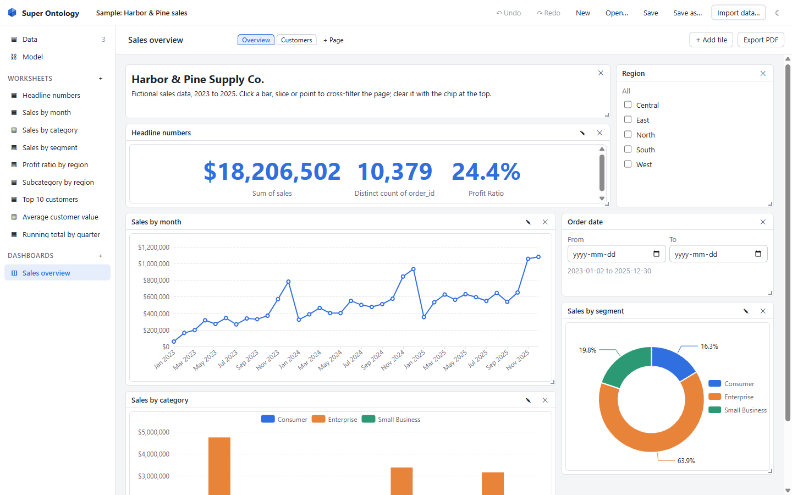
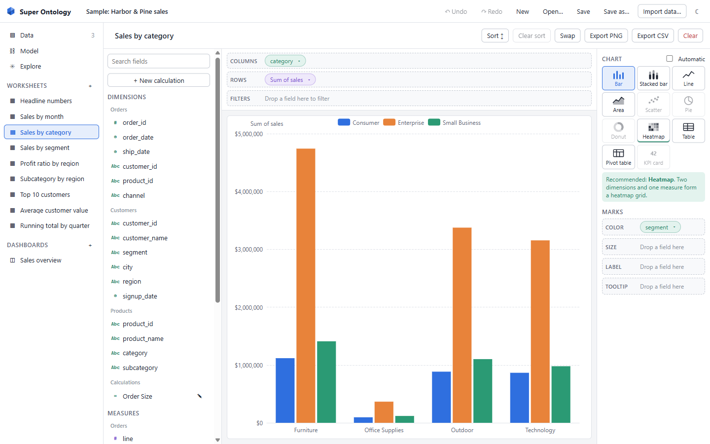
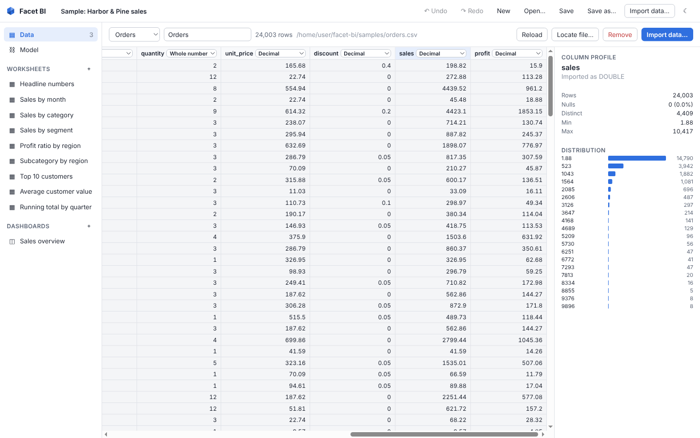
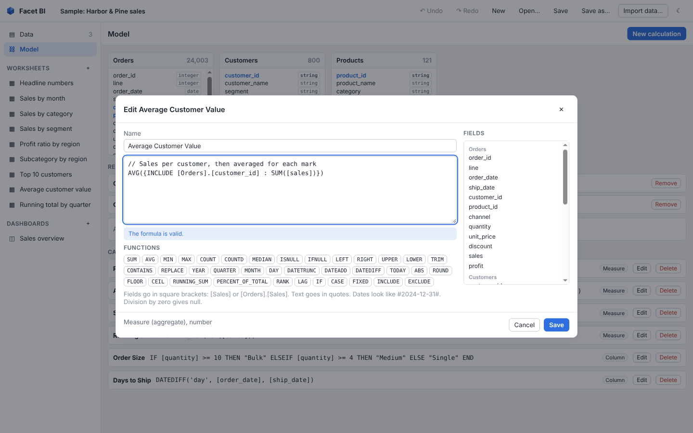
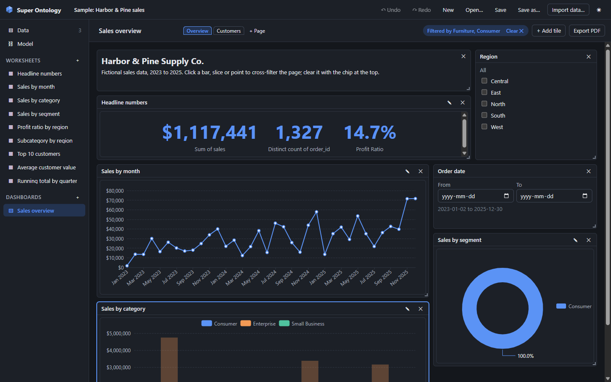

# Super Ontology

A free, open-source desktop app for exploring local data and building interactive dashboards. It gives you the drag-and-drop workflow of commercial BI tools without a licence or a cloud account. Your data stays on your computer: Super Ontology makes no network requests and has no telemetry.

**Status: v0.1, early.** It works end to end and is tested on Windows, macOS and Linux, but expect rough edges. Installers are not code-signed yet.



## What it does

- **Import local files.** CSV, TSV, Parquet, JSON and Excel (.xlsx), by file dialog or by dragging files onto the window. Preview the rows, change any column's detected type, and see a profile of each column: nulls, distinct values, min and max, and a histogram. Reload a table from its file; if the file is missing or its columns changed, you get a clear message and a "Locate file" button.
- **Model several tables.** Relationships are suggested from matching column names and types. Cardinality (one-to-many and so on) is detected from the data, and you are warned when a many-to-many relationship would multiply rows and inflate totals.
- **Build views by dragging fields** onto Columns, Rows, Color, Size, Label, Tooltip and Filters. Chart types: bar, stacked bar, line, area, scatter, pie, donut, heatmap, table, pivot table and KPI card. The app recommends a chart for the fields you picked. Date drill levels (year, quarter, month, week, day), sorting, Top N filters, number formats, and undo and redo.
- **Write formulas** in a readable language with aggregates, logic, text, date and maths functions, level of detail expressions (`FIXED`, `INCLUDE`, `EXCLUDE`) and table calculations (`RUNNING_SUM`, `PERCENT_OF_TOTAL`, `RANK`, `LAG`). Errors show the line, column and a plain-language explanation.
- **Compose dashboards** with several pages of resizable tiles: worksheets, text and slicers (list, date range, numeric range). Click a bar, slice, point or table row to cross-filter the rest of the page, and clear it with the chip at the top. Slicers only offer values that the page's other slicers and cross-filter leave.
- **Export** a chart as PNG, a view's data as CSV, and a dashboard page as PDF.
- **Save projects** as `.ontology` files: pretty-printed JSON that diffs well in Git.
- **Light and dark themes.**
- A generated, fictional **sample project** opens on first launch so there is something to explore straight away.

| Worksheet | Data and column profile |
|---|---|
|  |  |
| **Formula editor** | **Cross-filtering, dark theme** |
|  |  |

## Install

Installers are built by GitHub Actions when a version tag is pushed and attached to a GitHub release:

- **Windows:** `Super-Ontology-<version>-win-x64.exe` (NSIS installer, per-user, lets you pick the folder)
- **macOS:** `Super-Ontology-<version>-mac-arm64.dmg` (Apple silicon)
- **Linux:** `Super-Ontology-<version>-linux-x86_64.AppImage`

### The installers are not signed yet

Code signing certificates cost money, so v0.1 ships unsigned. Your operating system will warn you the first time. Only do the following if you downloaded the installer from this repository's Releases page.

- **Windows SmartScreen** shows "Windows protected your PC". Click **More info**, then **Run anyway**.
- **macOS Gatekeeper** says the app "cannot be opened because the developer cannot be verified" or that it "is damaged". Drag Super Ontology to Applications, then right-click (or Control-click) it and choose **Open**, and confirm. If that does not offer Open, go to **System Settings > Privacy & Security** and click **Open Anyway** next to the Super Ontology message. As a last resort, in Terminal: `xattr -dr com.apple.quarantine "/Applications/Super Ontology.app"`.
- **Linux:** make the AppImage executable (`chmod +x Super-Ontology-*.AppImage`) and run it. Some distributions need `libfuse2` for AppImages.

## Build from source

You need [Node.js](https://nodejs.org/) 22.12 or later (24 recommended) and Git. No Rust or C++ toolchain is needed: DuckDB ships prebuilt binaries.

```bash
git clone https://github.com/ariuka-ganzo/super-ontology.git
```

```bash
cd super-ontology
```

```bash
npm ci
```

Run the app in development mode with hot reload:

```bash
npm run dev
```

Checks and tests:

```bash
npm run lint
```

```bash
npm run typecheck
```

```bash
npm test
```

End-to-end tests drive the real app with Playwright. They need a build first; on Linux without a display, run them under `xvfb-run -a`.

```bash
npm run build
```

```bash
npx playwright test
```

Build an installer for the current platform (output goes to `release/`):

```bash
npm run package
```

Or an unpacked app folder, which is quicker:

```bash
npm run package:dir
```

A packaged app can check that its DuckDB engine loads, then exit. It prints `ONTOLOGY_SMOKE_OK` (and writes it to the file named by `ONTOLOGY_SMOKE_OUT`, if set):

```bash
"release/linux-unpacked/super-ontology" --smoke-test
```

Regenerate the sample data (it is deterministic, so the output does not change unless the script does):

```bash
node scripts/generate-sample.mjs
```

## Performance

Measured target: a 1 million row CSV (52 MB, 8 columns) imported and charted in under 5 seconds.

| | Result |
|---|---|
| Import, engine time | 0.80 to 0.85 s |
| Import, from clicking Import to the data view being ready | 0.90 to 1.45 s |
| First chart (sum of sales by region), from adding the fields to the chart drawn | 0.19 to 0.23 s |
| **Total, import plus first chart** | **1.1 to 1.7 s** over 3 runs |

Measured on the packaged Linux build in a cloud container with 4 vCPUs (Intel Xeon, 2.1 GHz). To measure on your own machine:

```bash
ONTOLOGY_PERF=1 npx playwright test tests/e2e/perf.spec.ts
```

Queries run on DuckDB's own threads, so the window stays responsive while they run. A query that takes more than a moment shows a **Cancel** button.

## How it works

Super Ontology is an Electron app. The renderer (React and TypeScript) is sandboxed and talks to the main process through a small, typed API. The main process runs [DuckDB](https://duckdb.org/) for all data work. Charts use [Apache ECharts](https://echarts.apache.org/).

The core is a compiler, in `src/shared/compiler`, that turns a view (the fields on each shelf, plus filters) into one SQL statement. It applies steps in this order:

1. Data source filters
2. Joins from model relationships, including only the tables the view needs
3. Context filters
4. `FIXED` expressions
5. Dashboard slicers and cross-filters, then the worksheet's dimension filters and Top N filters together. As in Tableau, Top N ranks only rows that passed the earlier steps, so to get "top 10 within a region", make the region filter a context filter
6. Aggregation at the level of detail set by the shelves (`INCLUDE` and `EXCLUDE` are computed here)
7. Measure filters
8. Table calculations, then sort and row limit

See [docs/ARCHITECTURE.md](docs/ARCHITECTURE.md) for the full design, and [docs/RESEARCH.md](docs/RESEARCH.md) for the reasoning behind the scope.

### Formula reference

Fields go in square brackets: `[Sales]`, or `[Orders].[Sales]` when two tables share a name. Text goes in quotes, dates look like `#2024-12-31#`, and `//` starts a comment.

| Kind | Functions and syntax |
|---|---|
| Aggregates | `SUM AVG MIN MAX COUNT COUNTD MEDIAN` |
| Logic | `IF … THEN … ELSEIF … ELSE … END`, `CASE [x] WHEN … THEN … ELSE … END`, `AND OR NOT`, `ISNULL(x)`, `IFNULL(x, fallback)` |
| Text | `LEFT RIGHT UPPER LOWER TRIM CONTAINS REPLACE`, and `+` joins text |
| Dates | `YEAR QUARTER MONTH DAY`, `DATETRUNC('month', d)`, `DATEADD('day', 7, d)`, `DATEDIFF('day', start, end)`, `TODAY()` |
| Maths | `ABS ROUND FLOOR CEIL`, `+ - * /`. Division by zero gives null instead of an error |
| Level of detail | `{FIXED [Region] : SUM([Sales])}`, `{INCLUDE [Customer] : SUM([Sales])}`, `{EXCLUDE [Month] : SUM([Sales])}` |
| Table calculations | `RUNNING_SUM(SUM([Sales]))`, `PERCENT_OF_TOTAL(…)`, `RANK(…)`, `LAG(…, 1)` |

How the level of detail expressions behave:

- `FIXED` is computed at its own dimensions before dimension filters (context filters still apply), then attached to every row. It works like a calculated column, so use `AVG` or `MIN` rather than `SUM` when the view is coarser than its dimensions.
- `INCLUDE` is computed at the view's dimensions plus its own, after dimension filters, and then aggregated to the view. Wrap it in an aggregate, for example `AVG({INCLUDE [Customer] : SUM([Sales])})`.
- `EXCLUDE` is computed at the view's dimensions minus its own, after dimension filters, and repeated for each mark.

Table calculations run along the first dimension on Columns (or Rows, then Color) and restart for each value of the view's other dimensions. To run them along a different dimension, choose it under **Table calculations** in the worksheet's side panel.

A saved calculation is a **calculated column** when it works row by row, or a **measure** when it aggregates.

## Privacy and security

- No network access: the app blocks every web request that is not one of its own files, and it has no telemetry or update checks.
- The renderer runs with `contextIsolation`, `sandbox` and no Node integration, under a strict Content Security Policy. The preload script exposes named functions only, and the main process validates every message with a schema and checks that it came from the app's window.
- The renderer never sends SQL. It sends a description of the view, and the main process compiles it. Every identifier is quoted and every value is a bound parameter; formula text only reaches SQL through the parser.
- DuckDB runs as two instances. The one that runs queries has file access disabled and its configuration locked, so it cannot read or write files or install extensions. A second instance only runs fixed import statements, with the path of a file you chose bound as a parameter, and only for data file extensions (`.csv`, `.tsv`, `.parquet`, `.json`, `.xlsx` and similar), even when the path comes from a project file. DuckDB extensions are never downloaded.
- Data values and file names are escaped before they are shown, including in chart tooltips. CSV exports prefix cells that start with `=`, `+`, `-` or `@` with an apostrophe so spreadsheets do not run them as formulas.

## Known limitations in v0.1

- **Data is not embedded in projects.** A `.ontology` file stores paths to your data files (relative to the project where possible). Moving a project to another computer means moving the data too, then using **Locate file** if the paths differ.
- **Excel:** `.xlsx` only (not the older `.xls`). Only the first sheet of a workbook is imported (there is no sheet picker yet), and its first row must be the header. Cells with formulas are read as their last saved values.
- **Data is held in memory** while a project is open. Very large files (many gigabytes) may not fit.
- **Charts** draw at most 10,000 rows. Larger results are cut off with a visible notice; CSV export always writes every row.
- **Slicers** apply to every worksheet on their page that is related to the slicer's table.
- **Table calculations** in one view all run along the same dimension.
- **Filters on table calculations** are not supported.
- **Macs with Intel processors:** the release workflow builds for Apple silicon only.
- **Accessibility:** keyboard navigation works for menus, dialogs and forms, but charts and drag and drop need a mouse.
- Not in v0.1: live database connections, data preparation steps, maps, importing other tools' files, sharing or a server, row-level security, and AI features. See [docs/RESEARCH.md](docs/RESEARCH.md) for what is planned.

## Licence

[MIT](LICENSE). Third-party components and their licences are listed in [THIRD_PARTY_NOTICES.md](THIRD_PARTY_NOTICES.md).

Super Ontology is an independent project, not affiliated with or endorsed by Microsoft or Salesforce. Power BI and Tableau are trademarks of their respective owners.
